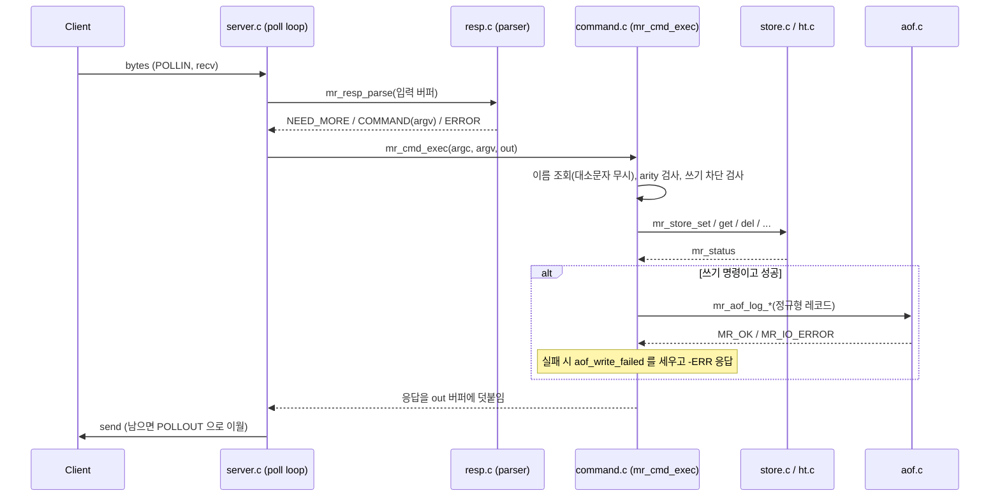

# 아키텍처

## 모듈 구성과 의존

코드는 소켓을 모르는 **core**와 네트워크를 다루는 **server**로 나뉜다. 의존은 아래에서 위로만 흐른다(core는 server를 모른다). 빌드는 core+server를 `libminiredis.a`로 묶고, `src/app/main.c`와 테스트가 그 라이브러리에 링크한다.

```
 src/app/main.c ─────────────► server.h      CLI 파싱, 시그널, 종료 코드
                                  │
 ┌────────────── server ──────────▼───────────────────────────┐
 │ server.c   poll 이벤트 루프, 연결 관리, cron                 │
 │ resp.c     RESP2 요청 파서 / 응답 직렬화 (스트리밍)          │
 │ command.c  명령 테이블·디스패치·AOF 기록 순서                │
 │ log.c      stderr 로그                                       │
 └───────────────┬────────────────────────────────────────────┘
                 │ (mr_cmd_exec 는 소켓을 모른다)
 ┌────────────── core ───────────▼────────────────────────────┐
 │ store.c   키-값, TTL, lazy/active 만료, 무효화, INCR         │
 │ aof.c     AOF 기록·재생·압축                  ──► store.h    │
 │ ht.c      해시 테이블(체이닝+점진적 리해싱, scan)            │
 │ glob.c    glob 매칭      clock.c  wall/mono 시계(주입 가능)  │
 │ status.c  mr_status 코드 → 문자열                            │
 └────────────────────────────────────────────────────────────┘
```

| 모듈 | 파일 | 책임 | 의존 |
|---|---|---|---|
| ht | `src/core/ht.c` | 바이너리 안전 해시 테이블, 점진적 리해싱, 커서 scan | status |
| store | `src/core/store.c` | 문자열 키-값, TTL, 만료(lazy/active), INCR, KEYS/SCAN, 무효화 | ht, glob, clock |
| aof | `src/core/aof.c` | RESP 형식 로그 기록/재생/압축, fsync 정책 | store, clock |
| glob | `src/core/glob.c` | Redis 호환 glob 매칭 | - |
| clock | `src/core/clock.c` | wall(`CLOCK_REALTIME`)/mono(`CLOCK_MONOTONIC`) ms, 테스트용 주입 | - |
| resp | `src/server/resp.c` | 요청 파서(multibulk/inline), 응답 작성기, 버퍼 | status |
| command | `src/server/command.c` | argv → 저장소 호출 → AOF 기록 → RESP 응답 | store, aof, resp |
| server | `src/server/server.c` | 소켓, `poll`, 연결별 버퍼, cron, 종료 | command, store, aof |

설계 포인트: `mr_cmd_exec(env, argc, argv, out, flags)`는 소켓을 모르는 순수 함수라 네트워크 없이 단위 테스트할 수 있고(`tests/unit/test_command.c`), 서버는 `mr_server_run_once()`로 한 틱만 돌릴 수 있어 기능 테스트가 스레드 없이 서버 틱과 클라이언트 소켓 조작을 번갈아 수행한다. 시계는 `mr_clock`으로 주입되어 TTL·sweep·idle timeout 테스트가 가짜 시계로 결정적이다.

## 요청 처리 흐름

한 틱(`mr_server_run_once`, `src/server/server.c`)의 순서:

```
            ┌──────────────────────────────────────────────────────┐
            │ 1. build_pollfds   listen + 연결별 POLLIN(+POLLOUT)  │
            │ 2. poll(timeout)   처리 못 한 입력이 있으면 timeout 0 │
            │ 3. accept_clients  틱당 최대 128, maxclients 검사     │
            │ 4. 연결마다 service_conn                              │
            │      conn_read    틱당 최대 max_read_per_tick(1MB)    │
            │      conn_process 틱당 최대 max_cmds_per_tick(1000)   │
            │      conn_flush   응답을 곧바로 send, 남으면 POLLOUT  │
            │ 5. cron (100ms 주기): sweep, AOF tick, idle timeout   │
            │ 6. reap            닫힌 연결 회수                     │
            └──────────────────────────────────────────────────────┘
```

명령 하나(`conn_process` 안)의 경로:



핵심 규칙:

- **명령은 끝까지 실행된 뒤 다음 명령이 시작된다.** 파싱 → 실행 → AOF 기록 → 응답 작성이 한 호출 안에서 끝나므로 명령 단위로 원자적이다(락 없음).
- **응답은 AOF 기록이 성공한 뒤에 만든다.** `+OK`를 받았다면 그 변경은 AOF 파일에 write되어 있다(fsync 시점은 정책에 따름). 기록 대상은 "성공한 변경"뿐이다.
- **공정성**: 한 연결이 루프를 독점하지 못하도록 틱당 읽기 바이트와 명령 수를 제한한다. 남은 입력이 있으면(`input_pending`) 다음 틱에 `poll` timeout 0으로 이어서 처리한다.
- **프로토콜 오류**(문법 위반, 상한 초과)는 복구할 수 없다. `-ERR Protocol error: ...`를 보내고 연결을 닫는다.
- **`QUIT`** 뒤에 파이프라인된 명령은 실행하지 않는다.
- **보호 장치**: 연결당 미처리 입력 128MB, 미전송 출력 256MB 상한(초과 시 연결 종료), bulk 최대 64MB / 인자 최대 1,048,576개 / inline 한 줄 64KB.
- 시작 순서: AOF 재생을 **먼저** 하고 그 뒤에 포트를 연다(재생 중 접속한 클라이언트가 빈 DB를 보지 않게).

## 종료

`SIGINT`/`SIGTERM` 핸들러는 플래그만 세운다. 루프가 플래그를 보고 빠져나오면 `mr_server_destroy`가 남은 출력을 블록 없이 보낸 뒤 연결을 닫고 AOF를 fsync·close하며, 정상이면 종료 코드 0이다(스모크 테스트가 확인). `SIGPIPE`는 무시한다.
